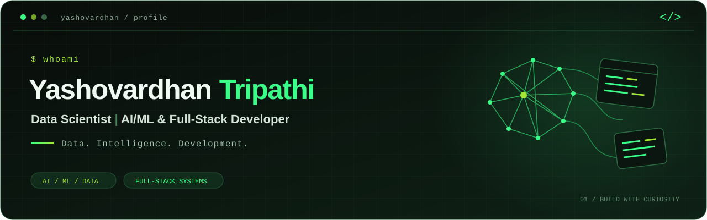

<p align="center">
  
</p>

<p align="center">
  <a href="https://www.linkedin.com/in/yashovardhan-tripathi-05220225a"></a>
  <a href="mailto:yashovardhan0001@gmail.com"></a>
  <a href="https://www.instagram.com/yashovardhantripathi/"></a>
</p>

<p align="center">
  <a href="#about-me">About</a> &nbsp; / &nbsp;
  <a href="#selected-projects">Projects</a> &nbsp; / &nbsp;
  <a href="#technology-stack">Stack</a> &nbsp; / &nbsp;
  <a href="#experience">Experience</a> &nbsp; / &nbsp;
  <a href="#github-activity">Activity</a>
</p>

## About me

Turning raw data into meaningful insights and bold ideas into intelligent, practical applications.  
I bring together data science, AI/ML, and full-stack development to build solutions for real-world problems.  
Driven by curiosity, I enjoy experimenting, solving challenges, and turning what I learn into software people can use.

**Open to internships, full-time roles, and project collaborations** in AI/ML, data science, and software development.

```text
$ cat interests.txt
  Data science & machine learning
  Computer vision, NLP & LLM applications
  Full-stack development, MLOps & DevOps
```

## Selected projects

### 01 / CrowdShield AI

**Computer vision for crowd awareness.** A YOLO and OpenCV project for people detection, crowd-density estimation, and congestion analysis. Includes overcrowding alerts and alternate-route suggestions to support crowd management at large events.

`Python` `YOLO` `OpenCV` `Computer Vision`

**Recognition:** Consolation Prize, SunHacks 2025.

### 02 / TimeConnector

**A social platform built with Django.** Supports text and image posts, likes, comments, profiles, friend requests, and following. Brings together privacy controls, blocking, staff moderation, authenticated REST APIs, and real-time WebSocket notifications in a responsive interface.

`Python` `Django` `REST APIs` `WebSockets` `Bootstrap`

**Built during:** The Developers Arena internship.

### 03 / Personal Productivity Suite

**Everyday utilities, one Python toolkit.** A command-line application combining a calculator, persistent notes, countdown timer, stopwatch, file organizer, and unit converter. Includes notes search and exports, local backup and restore, and file-organization previews.

`Python` `JSON` `CLI` `File Automation`

**Built during:** The Developers Arena internship.

### 04 / Student Performance Prediction

**From structured data to an interactive ML application.** A regression pipeline for estimating mathematics scores from reading and writing scores and student background features. Combines preprocessing, model comparison, and evaluation with a Flask API and an interactive HTML, CSS, and JavaScript frontend.

`Python` `Scikit-learn` `Ridge Regression` `Flask` `JavaScript`

**Built during:** AI Tech Gen internship.

## Technology stack

<p>
  
  
  
  
  
</p>

| Area | Technologies |
| :--- | :--- |
| **Languages** | Python · C++ · SQL · JavaScript · HTML · CSS |
| **Data & machine learning** | Pandas · NumPy · SciPy · Scikit-learn · XGBoost · PyTorch · TensorFlow |
| **NLP & generative AI** | NLTK · Hugging Face · LangChain · LLMs |
| **Computer vision** | OpenCV · YOLO |
| **Frontend** | React · Tailwind CSS · Bootstrap · Vite |
| **Backend** | Django · Flask · FastAPI · Node.js · NestJS · REST APIs |
| **Databases** | MySQL · PostgreSQL · MongoDB |
| **Visualization & analysis** | Matplotlib · Seaborn · Microsoft Excel |
| **Engineering focus** | Software development · MLOps · DevOps |
| **Development tools** | Git · GitHub · Jupyter · Google Colab · VS Code · Cursor · Antigravity |

## Experience

| Organization | Experience |
| :--- | :--- |
| **The Skybrisk** | Data Science Intern · **August 2026–present** |
| **Zidio** | Internship · **September–December 2026** · Ongoing; expected completion in December |
| **CodSoft** | Data Science Intern · **August 2025** and **August 2026** · Two separate one-month internships |
| **AI Tech Gen Technologies** | AI/ML Intern |
| **The Developers Arena** | Python Intern |

## Education & recognition

**B.Tech in Computer Science & Engineering — Artificial Intelligence & Machine Learning**  
Sandip University · Expected graduation **2027** · **CGPA: 8.49/10**

- **Top 2 at college level · Smart India Hackathon (SIH).**
- **Top 5 · PVG Hackathon 2025** — Handwriting and Text Detector AI.
- **Consolation Prize · SunHacks 2025** — CrowdShield AI.

## GitHub activity

<p align="center">
  <a href="https://github.com/Yashovardhan-Tripathi?tab=overview"></a>
  <a href="https://github.com/Yashovardhan-Tripathi?tab=repositories"></a>
</p>

<p align="center">
  
</p>

<p align="center">
  
</p>

### One contribution at a time

<p align="center">
  
</p>

<p align="center">
  <b>Have an idea worth building?</b><br />
  Let's turn it into something useful.<br /><br />
  <a href="mailto:yashovardhan0001@gmail.com">Start a conversation ↗</a>
</p>

<!-- Stats: github-readme-stats. Snake: Platane/snk. Activity graph: GitHub contribution calendar. -->
